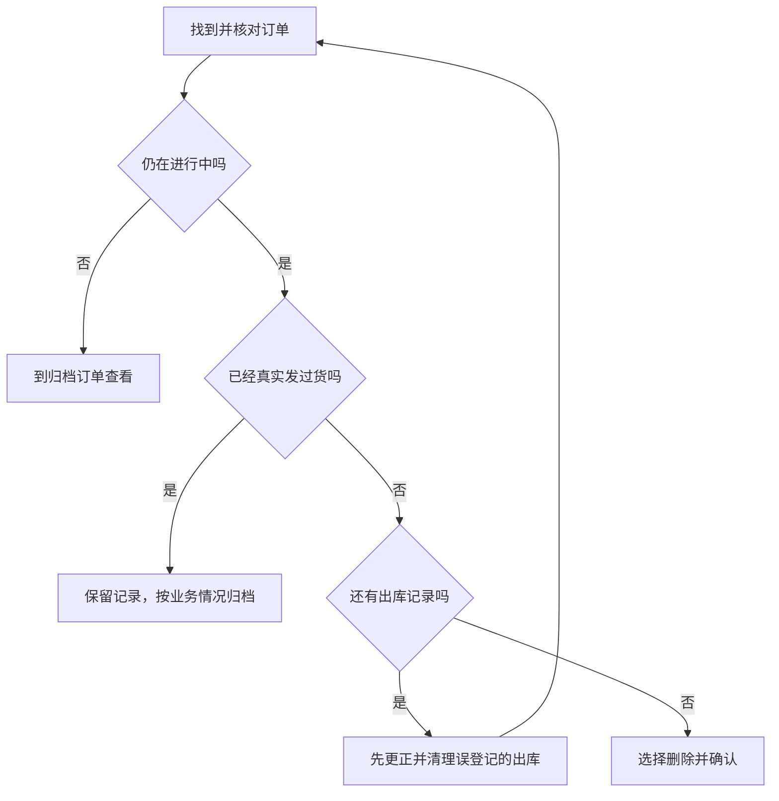

# 给日常使用者的操作说明

这篇用于回答“在哪里、怎么点、怎么用”。先讲用户当前要做的事，不要把接口、状态码、权限码或数据库规则念给用户。账号能否操作以本轮提供的实际授权为准。需要核对复杂条件时再读 operations 或 roles 主题。下列步骤是说明，AI 不替用户提交修改。

## 手机上搜索和筛选

支持搜索的列表页在顶部提供放大镜入口。点开后输入文字或编号，再点“确认”应用搜索；提示会说明当前页面支持搜哪些内容。品类、状态、日期等条件统一放在列表的“筛选”面板里，调整后点“确认”才生效，点“取消”保留原来的条件。面板内“重置”用于恢复默认条件，仍需确认；列表旁的“清空”用于直接清空已选筛选条件。

手机列表的卡片详情中直接展示成品的物料构成和已填写备注，先在卡片中核对；电脑表格保留“查看物料”入口。

## 查今天的成品出入库

查询今天的入库和出库记录，按业务日期筛选。入库和出库都只把有效单计入正常数量，作废记录单独说明。跨日更正数量属于库存调整，有调整时另列，不能混称正常入库或发货。

默认回答先给“今天入库多少、出库多少、有无需要注意的情况”。没有要求明细时，不必展开所有单据。用户追问某个成品或订单再查相应明细。不同计量单位不能混加；当前库存不要直接用今天的入库减出库代替。

完整统计与明细展示是两回事：明细只显示部分时，仍可以使用完整匹配记录算出的合计。只有数据确实未查齐才说“还有部分记录未核对”。不要输出技术性的截断警告，也不能靠单号连续猜测记录齐全。

## 新建和查看销售订单

1. 打开“销售订单”。
2. 新建时选择客户和成品，填写数量、交货日期以及需要的备注，再保存。
3. 查已有订单时，在页面搜索框输入订单号、客户名或成品编号，找到对应订单。

“还没发货的数量”就是这张订单要交的数量减去实际已发数量。订单已经结案归档时，即使有数量差，也不能再登记发货。

## 删除误建的销售订单

1. 打开“销售订单”，找到要删除的订单，先核对订单号、客户和数量。
2. 打开这行的操作菜单，选择“删除”。如果没有这个操作，先核对当前账号授权；没有删除权限时联系超级管理员。
3. 看清确认提示，再确认删除。删除后订单从列表消失，不能在列表里直接找回。

只有仍在进行中、实际已发数量为零、并且没有任何出库记录的订单可以删除。已作废但没有删除的出库记录也会挡住订单删除。误登记的出库应先在“成品出库”中作废，再删除该作废记录，然后重新检查订单。已经真实发出的货不能当成登记错误作废，也不能为了删订单而删掉真实发货依据。

已归档订单在“归档订单”查看；误归档需要原归档人在具备相应授权时回退，再核对删除条件。正常完成或中止交付的真实订单应保留记录，按业务情况归档。

需要图示时，可在文字步骤后展示下面的简图，不要显示图形源代码：

## 调整 BOM 结构

BOM 结构就是新建成品时可选的分类、分组、物料和选择规则。修改它不会改掉已经保存的成品档案或历史订单。

1. 从“业务导航”打开“BOM 结构”（它和“物料与 BOM”是同级页面）。手机上先点底部“更多”打开完整导航。品类分支默认折叠；有下属类型时，先展开品类，再点具体类型，例如“旋转XK3 → 焊线 / 插线”。点击父品类只折叠或展开，不打开父品类编辑区。
2. 右侧结构也默认折叠，点箭头逐层展开，或点“展开全部”。在要调整的位置点击“+”添加物料或分组；需要改名、隐藏或调整位置时使用对应行的操作菜单。切换品类会保留本次主动展开的分支。
3. 查看分组的单选、多选和数量设置是否符合实际需要。先点“预览”，试着选一遍物料。
4. 确认无误后点“保存结构”。没有保存的调整还没有生效。

新建品类时填写品类名称和编号开头；需要区分 A、B 等类型时勾选“再分几种类型”，只填类型名称。创建后展开左侧新品类即可看到各类型，分别搭建物料结构，再点“保存结构”一并保存。类型不需要另外填写代号，成品编号沿用品类的编号开头。保存前的新品类与各类型结构只暂存于当前页面，离开或刷新会丢失；不需要时可在新品类的右键菜单中选择“丢弃草稿”。

已被成品档案使用的物料不能随意改名、换组或删除。旧物料不再使用时可设为不可选，再新增正确的物料。已经保存的成品需要换构成时，应另外建立新的成品档案。

如果账号不能打开或维护这个页面，根据本轮实际授权直接说明，并联系超级管理员安排；不要泛泛说“无法确认权限”。

## 查看 AI 使用情况

有权限时从“系统 → AI 工作台”查看使用情况。先保存服务地址和 API Key，再查看账户余额；“刷新余额”重新向服务商查询当前余额，不随所选统计日期变化。

成员使用金额按所选时间范围内记录的 token 数量和系统内置模型单价估算，可能与服务商实际扣费不同。余额获取失败不代表余额为零，用量未取得或只取得部分时，也不能据此认为没有消耗。

## 分析页怎么用

分析页主要帮你看两件事：一是客户、订单、成品和出入库记录之间的关系，二是订单的交货安排和发货进度。

1. 打开“分析页”，先选要看的时间范围。
2. 想核对某一张单时，优先填订单号；想看某个成品或客户，就使用对应筛选，避免一次看太多内容。
3. 在业务关系图中点选对象，查看它关联的订单、成品或出入库情况。
4. 在交付进度区域对照交货日期、已发数量和还没发货的数量，找出需要跟进的订单。

当前库存是现在还能用的库存，不是所选日期当天的历史库存。交期只是安排，不代表已经为该订单专门预留库存。页面提示范围太大时，缩短日期或指定订单号再看。

## 入库、发货和登记错误

- 成品检验合格后，在“成品入库”登记。当天填错可按授权修正或作废；跨天发现的数量差异通常请有权限的人做库存调整。
- 给销售订单登记发货时，先核对客户、订单、成品和本次数量。库存和该单还没发货的数量都要够。
- 出库登记写错且订单尚未归档时，按权限作废错误记录，再按实际情况重新登记。
- 客户真的退回货物属于另一项业务，当前系统没有销售退货流程，请业务负责人确认处理办法，不能直接作废真实发货代替退货。

## 看图、遇到提示和查权限

用户上传页面截图时，直接根据截图中能看到的按钮和文字说明下一步。不加“能否识别取决于模型”一类开场说明；图片确实看不清才指出需要补充哪一部分。

遇到登录过期，提示重新登录。没有操作权限，说明联系超级管理员。记录被别人改过，提醒刷新核对后再操作。不要把状态码和内部权限名称抛给用户。
